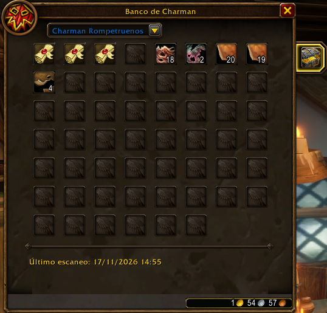
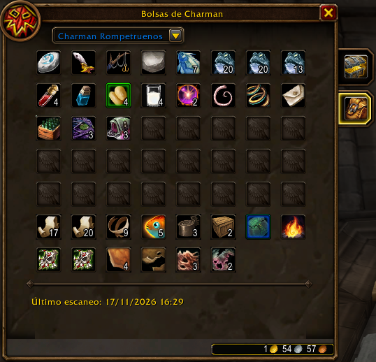
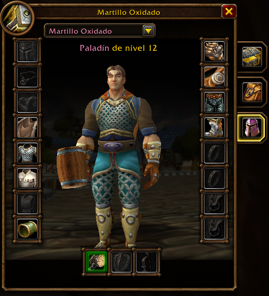
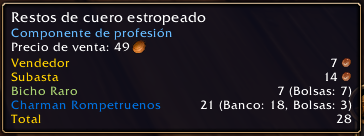

# PocketBank

[Español](README.md)

Addon for **WoW Forever** (Interface 16001) that shows the contents of your bank, bags and equipment, including those of the other characters on your account, without visiting the bank. A modern alternative to BankItems, which is no longer supported.

> **Status:** version 0.5.0. It shows the bank, bags and equipment of every character, and in every item tooltip how many each one holds; the rest arrives in the next versions.

## Requirements

- WoW Forever (`_forever_` client, Interface 16001).

## Installation

From the CurseForge app (select your Forever installation) or at https://www.curseforge.com/wow/addons/pocketbank. Manually: copy the `PocketBank` folder into `World of Warcraft\_forever_\Interface\AddOns\` and restart the game.

## Usage

1. Visit the bank once: PocketBank saves its contents and says so in the chat ("Bank saved (N items)"). It saves again every time you open it.
2. From anywhere, click the minimap button or type `/pb` to open or close the bank window. `Esc` also closes it.
3. To see your bags, click the bag tab on the right of the window. They are saved automatically when you log in and whenever they change (backpack, bags and profession bag; not the keyring).
4. To see your equipment, click the helmet tab: it shows a copy of the character sheet. It is saved automatically when you log in and whenever you change gear. The 3D model is shown for the logged-in character and for others of the same race and sex; for other races the game does not allow loading it.
5. To see another character's bank, bags or equipment, pick it in the dropdown at the top of the window. Each character must have visited the bank (for the bank) or logged in (for the bags and equipment) once.
6. Hover an item to see its tooltip; Shift + click links it in chat.
7. Anywhere in the game (bags, chat, vendors, auction house…), an item's tooltip shows how many each character of your account holds, split between bank, bags and equipment, and the total when several hold it.

The minimap button can be dragged around the minimap and remembers its position.

| Command | What it does |
|---|---|
| `/pb` or `/pocketbank` | Opens or closes the bank window |
| `/pb version` | Shows the version |
| `/pb debug`, `/pb frames`, `/pb paperdoll` | Diagnostics for support (saved on `/reload`) |

## Credits and license

**PocketBank** is developed and maintained by **WarCrafted**.
Copyright (C) 2026 WarCrafted.

Licensed under [WNCL-1.0](LICENSE): free to use, study, modify and share for non-commercial purposes. Selling or any commercial use requires written permission.

Copies and forks must keep this attribution and link to https://github.com/warcrafted-server/pocketbank.

### Third-party material

This project contains no third-party material.

Web: https://portal.warcrafted.com/
