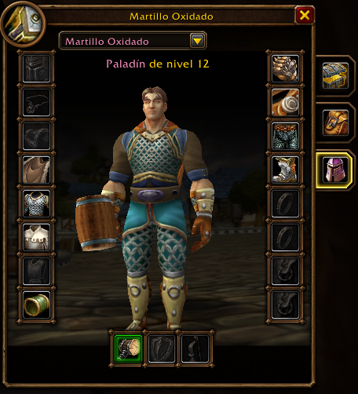

# PocketBank

[English](README.en.md)

Addon para **WoW Forever** (Interface 16001) que muestra el contenido de tu banco, bolsas y equipo, también el de los demás personajes de tu cuenta, sin tener que visitar el banco. Alternativa moderna a BankItems, que ya no tiene soporte.

> **Estado:** versión 0.6.0. Muestra el banco, las bolsas y el equipo de cada personaje, y en el tooltip de cada objeto cuántos tiene cada uno; el resto llega en próximas versiones.

## Requisitos

- WoW Forever (cliente `_forever_`, Interface 16001).

## Instalación

Desde la aplicación de CurseForge (elige tu instalación de Forever) o en https://www.curseforge.com/wow/addons/pocketbank. A mano: copia la carpeta `PocketBank` en `World of Warcraft\_forever_\Interface\AddOns\` y reinicia el juego.

## Uso

1. Visita el banco una vez: PocketBank guarda su contenido y lo dice en el chat («Banco guardado (N objetos)»). Se vuelve a guardar cada vez que lo abres.
2. Desde cualquier sitio, pulsa el botón del minimapa o escribe `/pb` para abrir o cerrar la ventana del banco. `Esc` también la cierra.
3. Para ver tus bolsas, pulsa la pestaña de la bolsa, a la derecha de la ventana. Se guardan solas al entrar al juego y cada vez que cambian (mochila, bolsas y bolsa de profesión; el llavero no).
4. Para ver tu equipo, pulsa la pestaña del casco: muestra una copia de la hoja de personaje. Se guarda solo al entrar al juego y cada vez que cambias de equipo. El modelo 3D sale en el personaje conectado y en los de su misma raza y sexo; con otras razas el juego no permite cargarlo.
5. Para ver el banco, las bolsas o el equipo de otro personaje, elígelo en el desplegable de arriba de la ventana. Cada personaje tiene que haber visitado el banco (para el banco) o haber entrado al juego (para las bolsas y el equipo) una vez.
6. Pasa el ratón por un objeto para ver su tooltip; Mayús + clic lo enlaza en el chat.
7. En cualquier parte del juego (bolsas, chat, vendedores, subasta…), el tooltip de un objeto indica cuántos tiene cada personaje de tu cuenta, repartidos entre banco, bolsas y equipo, y el total si lo tienen varios.

La ventana se puede arrastrar por el título o el fondo y recuerda su posición; `/pb reset` la devuelve a su sitio. El botón del minimapa se puede arrastrar alrededor del minimapa y recuerda su posición.

| Orden | Qué hace |
|---|---|
| `/pb` o `/pocketbank` | Abre o cierra la ventana del banco |
| `/pb reset` | Devuelve la ventana a su sitio por defecto |
| `/pb version` | Muestra la versión |
| `/pb debug`, `/pb frames`, `/pb paperdoll` | Diagnóstico para soporte (se guarda al hacer `/reload`) |

## Desarrollo

Se trabaja con una junction `AddOns\PocketBankDev` que apunta a esta carpeta, con su propio `PocketBankDev.toc` (ignorado por git). Solo una de las dos copias (publicada o dev) debe estar activa a la vez. Montarla o desmontarla exige el juego cerrado. El plan de trabajo y la cola de entregas están en `.agents/plans/` (no se sube a GitHub).

## Créditos y licencia

**PocketBank** está desarrollado y mantenido por **WarCrafted**.
Copyright (C) 2026 WarCrafted.

Licencia [WNCL-1.0](LICENSE): puedes usarlo, estudiarlo, modificarlo y compartirlo gratis con fines no comerciales. Venderlo o cualquier uso comercial requiere permiso por escrito.

Las copias y los forks deben conservar esta atribución y enlazar a https://github.com/warcrafted-server/pocketbank.

### Material de terceros

Este proyecto no contiene material de terceros.

Web: https://portal.warcrafted.com/
