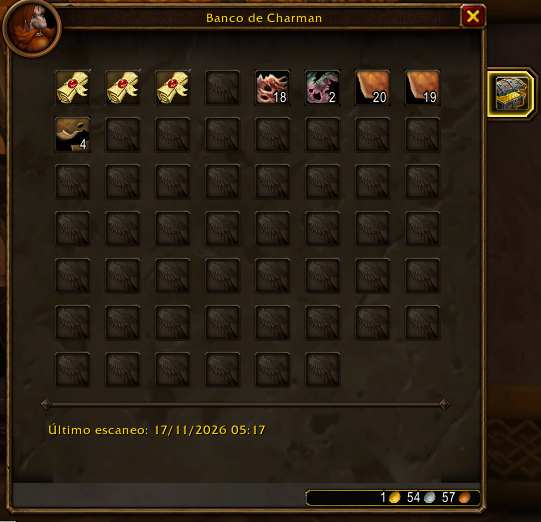

# PocketBank

[English](README.en.md)

Addon para **WoW Forever** (Interface 16001) que muestra el contenido de tu banco, bolsas y equipo, también el de los demás personajes de tu cuenta, sin tener que visitar el banco. Alternativa moderna a BankItems, que ya no tiene soporte.

> **Estado:** versión 0.1.0, la primera. Por ahora muestra el banco del personaje con el que juegas; los demás personajes, las bolsas, el equipo y el resto llegan en próximas versiones.

## Requisitos

- WoW Forever (cliente `_forever_`, Interface 16001).

## Instalación

Desde la aplicación de CurseForge (elige tu instalación de Forever) o en https://www.curseforge.com/wow/addons/pocketbank. A mano: copia la carpeta `PocketBank` en `World of Warcraft\_forever_\Interface\AddOns\` y reinicia el juego.

## Uso

1. Visita el banco una vez: PocketBank guarda su contenido y lo dice en el chat («Banco guardado (N objetos)»). Se vuelve a guardar cada vez que lo abres.
2. Desde cualquier sitio, pulsa el botón del minimapa o escribe `/pb` para abrir o cerrar la ventana del banco. `Esc` también la cierra.
3. Pasa el ratón por un objeto para ver su tooltip; Mayús + clic lo enlaza en el chat.

El botón del minimapa se puede arrastrar alrededor del minimapa y recuerda su posición.

| Orden | Qué hace |
|---|---|
| `/pb` o `/pocketbank` | Abre o cierra la ventana del banco |
| `/pb version` | Muestra la versión |
| `/pb debug`, `/pb frames` | Diagnóstico para soporte (se guarda al hacer `/reload`) |

## Desarrollo

Se trabaja con una junction `AddOns\PocketBankDev` que apunta a esta carpeta, con su propio `PocketBankDev.toc` (ignorado por git). Solo una de las dos copias (publicada o dev) debe estar activa a la vez. Montarla o desmontarla exige el juego cerrado. El plan de trabajo y la cola de entregas están en `.agents/plans/` (no se sube a GitHub).

## Créditos y licencia

**PocketBank** está desarrollado y mantenido por **WarCrafted**.
Copyright (C) 2026 WarCrafted.

Licencia [WNCL-1.0](LICENSE): puedes usarlo, estudiarlo, modificarlo y compartirlo gratis con fines no comerciales. Venderlo o cualquier uso comercial requiere permiso por escrito.

Las copias y los forks deben conservar esta atribución y enlazar a https://github.com/warcrafted-server/pocketbank.

### Material de terceros

Este proyecto no contiene material de terceros.

Web: https://portal.warcrafted.com/
